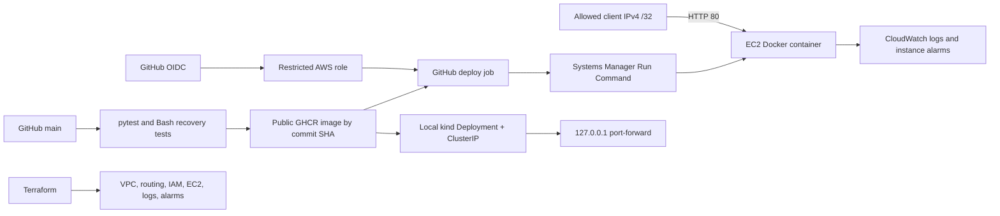

# CloudShip

CloudShip is a small, tested AWS delivery platform: Terraform provisions a
restricted EC2 environment, GitHub Actions publishes Docker releases to GHCR,
and AWS OIDC + Systems Manager deploy each exact image digest. Deployment checks
health and version, with recovery to a previous verified release. The same API
also runs in a separate local kind Kubernetes exercise.



## Verified progress

| Phase | Status |
| --- | --- |
| 0–2: prerequisites, FastAPI, Docker | Verified |
| 3: Terraform AWS infrastructure | Plan/apply/runtime checks and approved teardown verified |
| 4: GitHub CI/CD, OIDC, SSM, failed-test gate | Verified — [evidence](docs/PHASE4.md) |
| 5: automatic rollback | Verified distinct unhealthy release, failed workflow, exact previous image restored |
| 6: CloudWatch application logs | Verified actual startup/HTTP events, EC2 metrics and alarms |
| 7: local Kubernetes | Verified: two replicas, HTTP, logs, scaling, rolling update, Pod recovery and cleanup |
| 8: runbooks and interview preparation | Complete; verified evidence, operations and cleanup documented |

See [the evidence checklist](docs/EVIDENCE_CHECKLIST.md) for exactly what has been
observed. The project is a single-instance learning demo: no HA, zero-downtime,
public TLS, EKS or production-hardening claim is made.

**Final lifecycle:** All project AWS resources were removed with approval after
verification on November 24, 2026; the local kind cluster was removed too. The
application is no longer hosted on EC2. Source, images and genuine workflow
evidence remain available. `PAUSE_AUTO_DEPLOY=true` keeps ordinary pushes testing
and publishing without attempting deployment to the deleted host. To redeploy,
review costs, provision from the saved configuration, refresh repository variables,
verify SSM, and reset that variable to false. See [cleanup verification](CLEANUP.md).

## Prerequisites

- Git, Python 3.11, Docker Desktop using Linux containers.
- Terraform 1.17.x, AWS CLI v2 with `aws login` support, GitHub CLI.
- AWS workload account/profile with permission to provision the reviewed resources.
- kubectl; the project-local kind installer verifies the official binary checksum.
- AWS region `ap-southeast-2` (Sydney), explicit client IPv4 /32, and cost approval.

The GHCR application image is intentionally public. It contains no local AWS
settings/state or credentials. Only the GitHub build job has package-write access;
only the deployment job can request an OIDC token. No SSH or static AWS keys are used.

## Local application and tests

```powershell
python -m venv .venv
.\.venv\Scripts\python.exe -m pip install --require-hashes -r requirements-dev.txt
.\.venv\Scripts\python.exe -m pytest -q
$env:APP_VERSION = 'local-dev'
$env:ALLOW_FAILURE_DEMO = 'false'
$env:SIMULATE_UNHEALTHY = 'false'
.\.venv\Scripts\python.exe -m uvicorn app.main:create_app --factory --host 127.0.0.1 --port 8000
```

Endpoints: `/` identifies the service, `/health` reports application health, and
`/version` returns `APP_VERSION`. Both failure flags must explicitly be true to
simulate HTTP 503. Ordinary deployments set both false.

Windows skips the privileged Bash tests. Run the complete suite in Linux:

```powershell
docker build -t cloudship:test-tools -f tests/Dockerfile .
$projectRoot = $PWD.Path
docker run --rm --network none --mount "type=bind,source=$projectRoot,target=/workspace,readonly" cloudship:test-tools
```

The Linux tests run the real Bash script and jq/state-file logic with stateful
substitutes for external Docker/HTTP commands; they do not touch AWS or the actual
Docker daemon. GitHub separately runs the Bash suite under sudo on its disposable
runner. Actual container and cloud behavior is checked in the recorded live demos.

```powershell
docker build --pull -t cloudship:local-v1 .
docker run -d --name cloudship-local -p 127.0.0.1:8000:8000 -e APP_VERSION=local-v1 -e ALLOW_FAILURE_DEMO=false -e SIMULATE_UNHEALTHY=false cloudship:local-v1
curl.exe http://127.0.0.1:8000/health
docker logs cloudship-local
docker stop cloudship-local
docker rm cloudship-local
```

The image runs as UID/GID 10001. `UVICORN_PORT` defaults to 8000; update the port
mapping if you change it. Docker's restart policy is not image rollback.

## AWS and Terraform setup

Read [the Phase 3 guide](docs/PHASE3.md), establish a budget alert and approve costs
before provisioning. Never deploy this workload in the organization management
account. Never select a management-account root session for the `cloudship` profile.

```powershell
aws login --profile cloudship --region ap-southeast-2
aws sts get-caller-identity --profile cloudship --region ap-southeast-2
Copy-Item terraform/terraform.tfvars.example terraform/terraform.tfvars
```

Edit the ignored `terraform.tfvars` with **your** workload account ID and current
client IPv4 /32. Never commit that file. For a fork, update the GHCR namespace in
the workflow and deployment validators (`scripts/deploy.sh`, `scripts/deploy_ssm.py`),
both deployment test modules (`tests/test_deploy_shell.py`, `tests/test_deploy_ssm.py`),
and the Kubernetes image/version pair if using your own local release. Use your repository's actual immutable
OIDC subject in `terraform/locals.tf`; obtain it with:

```powershell
gh api repos/OWNER/REPOSITORY/actions/oidc/customization/sub
```

The trust must match the exact repository identity and `ref:refs/heads/main`.
Adding a GitHub job environment changes that subject and requires an intentional
trust-policy update. Do not use a wildcard subject as an authentication workaround.

```powershell
terraform -chdir=terraform init -lockfile=readonly
terraform -chdir=terraform fmt -check
terraform -chdir=terraform validate
terraform -chdir=terraform plan -out=deploy.tfplan
# Inspect the complete plan and approve billable creation before this step.
terraform -chdir=terraform apply deploy.tfplan
terraform -chdir=terraform output
```

The configuration creates 20 resources: networking, restricted ingress, one EC2,
instance/deployment IAM, GitHub OIDC, a log group and two metric alarms. Bootstrap
installs Docker/jq and prepares root-owned directories. It does not deploy the app.
Wait for both EC2 status checks and SSM Online. State is local and ignored: back it
up privately and reuse it for the same infrastructure. A fresh checkout without
state does not automatically adopt existing resources. A newer public AMI parameter
can propose EC2 replacement; review it rather than applying an unrelated change.

## GitHub delivery

Configure Actions repository variables from your outputs:

```powershell
gh variable set AWS_REGION --repo OWNER/REPOSITORY --body 'ap-southeast-2'
$role = terraform -chdir=terraform output -raw github_deploy_role_arn
$instance = terraform -chdir=terraform output -raw instance_id
gh variable set AWS_ROLE_ARN --repo OWNER/REPOSITORY --body "$role"
gh variable set EC2_INSTANCE_ID --repo OWNER/REPOSITORY --body "$instance"
```

Push to main: tests → commit-tagged public GHCR image → digest-pinned SSM deployment
→ matching health/version. Publishing uses GitHub's generated `GITHUB_TOKEN`; EC2
pulls the public image anonymously. Newly created GHCR packages start private;
change package visibility deliberately after reviewing the build contents.

`PAUSE_AUTO_DEPLOY=true` pauses **push** deployment while tests/publication continue.
Manual main-branch runs remain available. Clear/reset the variable after a demo.
`fail_ci_demo=true` creates a temporary failing unit test only on the manual runner.
`simulate_unhealthy=true` deliberately starts an unhealthy candidate only through
an explicit manual main-branch run. Recovery must restore the previous image and
still report the candidate deployment as failed. See [rollback operations](docs/PHASE5.md).

## Local Kubernetes

This is local Kubernetes in Docker, **not EKS and not EC2 orchestration**.
The pinned node image matches the installed kubectl 1.34 minor version.

```powershell
.\scripts\install-kind.ps1
New-Item -ItemType Directory -Path .artifacts -Force | Out-Null
$kc = Join-Path $PWD.Path '.artifacts\kind.kubeconfig'
.\.tools\kind.exe create cluster --name cloudship --kubeconfig $kc --image 'kindest/node:v1.34.11@sha256:44e222ee2132dab25ff87301682f89eb82c7880ea3a1bf543bfe9708fd08d67d' --wait 120s
kubectl --kubeconfig $kc --context kind-cloudship apply -f kubernetes/
kubectl --kubeconfig $kc --context kind-cloudship rollout status deployment/cloudship --timeout=180s
kubectl --kubeconfig $kc --context kind-cloudship get pods,deployments,services
kubectl --kubeconfig $kc --context kind-cloudship port-forward --address 127.0.0.1 service/cloudship 18080:80
```

In another terminal, call `http://127.0.0.1:18080/health` and `/version`. The manifest
pins a published digest and its corresponding version, with two non-root replicas,
resource bounds, probes and a ClusterIP Service. See [the local exercise](docs/PHASE7.md).

## Operations, security and costs

- [Architecture and boundaries](docs/ARCHITECTURE.md)
- [Troubleshooting and recovery runbook](docs/RUNBOOK.md)
- [CloudWatch verification](docs/PHASE6.md)
- [Evidence and honest resume claims](docs/EVIDENCE_CHECKLIST.md)
- [Interview questions](docs/INTERVIEW_QA.md)
- [Final reproducibility and verification](docs/PHASE8.md)

Compute plus public IPv4 is approximately **$0.0182/hour** for this Sydney t3.micro
before credits, plus EBS, logs, alarms and any chargeable traffic. An 8 GiB gp3 disk
is about $0.77/month and two standard alarms about $0.20/month before allowances.
Credits cover eligible charges only; taxes/non-covered usage can differ. The $5
budget is an alert, not a hard cap. No NAT, ALB, RDS, EKS or purchased domain is used.
The cloud host and its project storage/monitoring were deleted after the verified
demonstrations. A pre-existing unrelated stopped instance and 8 GiB disk remain
outside this project; their storage may still incur charges. No account-wide
zero-bill or global resource-absence claim is made.

Stop idle compute after cloud checks. Stopping releases an automatic public IPv4
but retains storage and alarms. To fully clean up, first pause automatic deployment,
review a fresh `terraform plan -destroy -out=cleanup.tfplan`, obtain deletion
approval, and apply that exact plan. Verify the project instance, attached disk,
networking, IAM/OIDC, alarms and log group are gone. Do not delete unrelated
resources. Delete only the project-created local cluster after the kind demo:

```powershell
.\.tools\kind.exe delete cluster --name cloudship --kubeconfig $kc
```

Credentials, state, personal inputs, raw logs, local tools and kubeconfig stay in
ignored paths. Genuine workflow links/API/CLI observations are recorded in the
evidence documents; no fabricated screenshots or production claims are used.

## Dependency maintenance

```powershell
.\.venv\Scripts\python.exe -m pip install pip-tools==7.6.2
.\.venv\Scripts\python.exe -m piptools compile --generate-hashes --no-emit-index-url --no-emit-trusted-host requirements.in
.\.venv\Scripts\python.exe -m piptools compile --generate-hashes --no-emit-index-url --no-emit-trusted-host --output-file=requirements-dev.txt requirements-dev.in
```

Review lock changes and rerun the full tests and image build. Runtime and test
locks must remain aligned; a mixed hashed/unhashed install fails on a fresh runner.
